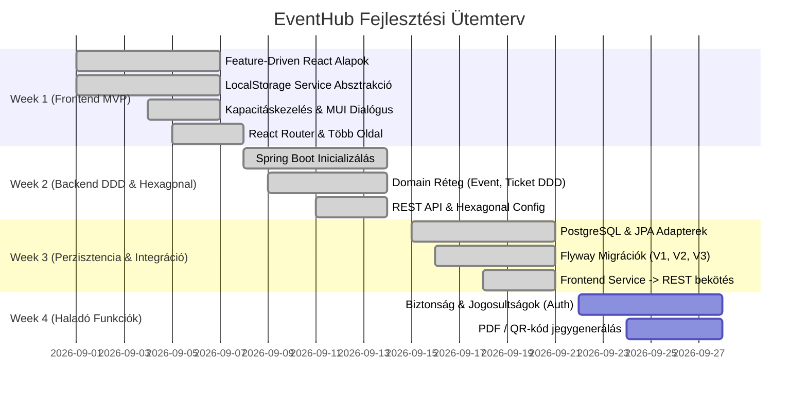

# EventHub - Fő Rendszerarchitektúra és Tervezési Dokumentáció

Ez a dokumentum az **EventHub** (Esemény- és Jegykezelő Rendszer) teljes architekturális tervét, komponensfelépítését, adatmodelljeit és több hetes fejlesztési roadmapjét tartalmazza.

---

## 1. Rendszer Áttekintés

Az EventHub célja egy modern, skálázható és felhasználóbarát eseményszervező és online jegyfoglalási platform biztosítása.

### Főbb Célok:
- **Tiszta rétegződés**: Az üzleti logika szigorúan elkülönül a megjelenítéstől és az adattárolástól.
- **Frontend-Backend függetlenség**: A frontend és a leendő backend különálló projektekben (`frontend/` és `backend/`) élnek.
- **Transzparens API absztrakció**: Az 1. héten a frontend egy Service/API absztrakciós rétegen keresztül kezeli az adatokat (LocalStorage-ben), így a későbbi Spring Boot REST API-ra váltás a React UI komponensek érintése nélkül történik.

---

## 2. Technológiai Stack

| Réteg | Technológia | Szerep |
|---|---|---|
| **Frontend UI** | React 19 + TypeScript | Felhasználói felület és interakciók |
| **Komponenskönyvtár** | Material UI (MUI v6) | Reszponzív, akadálymentes design rendszer |
| **Navigáció & Routing** | React Router (v7) | Kliensoldali útvonalkezelés (`/`, `/events/:id`, `/tickets`) |
| **Build & Dev Tool** | Vite | Gyors ESM bundler és HMR fejlesztői szerver |
| **Frontend Tesztelés** | Vitest + React Testing Library | Unit és integrációs komponens tesztelés |
| **Backend (2. héttől)** | Spring Boot 3.x (Java 21 LTS) | Domain-Driven Design (DDD) REST API |
| **Adatbázis (3. héttől)** | PostgreSQL | Relációs perzisztencia ACID garanciákkal |
| **Migráció** | Flyway / Liquibase | Verziózott adatbázis sémakezelés |

---

## 3. Repozitórium Struktúra

```
EventHub/
├── .gitignore                     # Gyökér szintű Git kizárások (frontend és backend egyben)
├── docs/                          # Tervezési és heti dokumentációk
│   ├── architecture.md            # Ez a fő rendszerterv
│   ├── week-01.md                 # 1. heti sprint összefoglaló (Frontend MVP)
│   ├── week-02.md                 # 2. heti sprint (Hexagonal Architecture & Domain DDD)
│   └── week-03.md                 # 3. heti sprint (JPA, Migrációk & REST Integráció)
│
├── backend/                       # Spring Boot Hexagonális Backend (Java 21)
│   ├── pom.xml                    # Maven projekt konfiguráció
│   ├── build.gradle               # Gradle konfiguráció
│   ├── README.md                  # Backend futtatási és tervezési dokumentáció
│   └── src/
│       ├── main/
│       │   ├── java/hu/eventhub/
│       │   │   ├── EventHubBackendApplication.java
│       │   │   ├── domain/        # Tiszta Java Domain (model, exception, ports)
│       │   │   ├── application/   # Használati esetek (port/in, service)
│       │   │   └── infrastructure/# Adapterek (configuration, persistence/jpa, web)
│       │   └── resources/
│       │       ├── application.properties
│       │       └── db/migration/  # Flyway SQL migrációk (V1, V2, V3)
│       └── test/                  # Domain, UseCase és Web tesztek (100% pass)
│
└── frontend/                      # React + TypeScript + MUI projekt
    ├── package.json               # Függőségek (React, MUI, React Router, Vitest)
    ├── tsconfig.json              # Path aliasok (@/* -> src/*)
    ├── vite.config.ts             # Vite konfiguráció és Vitest runner
    ├── index.html                 # HTML belépési pont
    └── src/
        ├── features/              # Feature-Driven modulok
        │   ├── events/            # Eseménykezelés modul
        │   │   ├── components/    # EventCard, EventList, CapacityBadge
        │   │   ├── hooks/         # useEvents hook
        │   │   ├── services/      # eventService.ts (API absztrakció)
        │   │   └── types/         # Event, Venue típusok
        │   └── ticket-booking/    # Jegyfoglalás modul
        │       ├── components/    # BookingDialog, BookingForm, BookingSuccess
        │       ├── hooks/         # useTicketBooking hook
        │       ├── services/      # ticketService.ts (Kapacitásellenőrzés, jegykiadás)
        │       └── types/         # Ticket, BookingRequest, CapacityExceededError
        │
        ├── pages/                 # React Router oldal-szintű komponensek
        │   ├── EventsPage.tsx     # Főoldali eseménykatalógus
        │   ├── EventDetailPage.tsx# Egyedi esemény részletező nézet
        │   └── TicketsPage.tsx    # Kiadott jegyek áttekintése
        │
        ├── shared/                # Globális megosztott modulok
        │   ├── types/             # Money értékobjektum
        │   ├── ui/                # Navbar, NotificationSnackbar, Theme beállítás
        │   └── utils/             # localStorage helper, codeGenerator, formatters, seedData
        │
        ├── test/                  # Tesztkörnyezet setup (vitest + RTL)
        ├── App.tsx                # Fő útvonalkezelő és elrendezés (Layout)
        └── main.tsx               # Belépési pont (ThemeProvider, CssBaseline)
```

---

## 4. Frontend Architektúra: Feature-Driven Design

A frontend a **Feature-Driven Architecture** mintát követi. Ennek lényege, hogy a forráskód nem horizontális technikai mappákba (pl. `components/`, `services/`, `models/`), hanem vertikális üzleti funkcionalitásokba (`features/events`, `features/ticket-booking`) van szervezve.

### Szigorú Tervezési Szabály:
> **A React komponensek SOHA NEM férhetnek hozzá közvetlenül a LocalStorage-hoz.**
> Minden adatolvasás és módosítás kizárólag a feature-specifikus service rétegen (`eventService`, `ticketService`) keresztül történhet.
>
> **Miért létszükséglet ez?**
> Amikor a 2. és 3. héten csatlakoztatjuk a Spring Boot REST végpontokat, kizárólag a `service` fájlok belső implementációját kell átírnunk `fetch()` / `axios()` hívásokra. A felhasználói felület (UI), a formok, a dialógusok és a React hookok egyetlen sora sem fog megváltozni!

---

## 5. Domain Modellek és Üzleti Szabályok

### 1. Helyszín (Venue)
```typescript
interface Venue {
  id: string;
  name: string;
  address: string;
  capacity: number; // Maximális befogadóképesség
}
```

### 2. Esemény (Event)
```typescript
interface Event {
  id: string;
  title: string;
  description: string;
  date: string; // ISO 8601 formátum
  venue: Venue;
  soldTicketsCount: number; // Eladott jegyek száma
  price: Money;
  category?: string;
  imageUrl?: string;
}
```

### 3. Jegy (Ticket)
```typescript
interface Ticket {
  id: string;
  eventId: string;
  participantName: string;
  participantEmail: string;
  ticketCode: string; // Formátum: EVT-YYYY-XXXX (pl. EVT-2026-B9F2)
  price: Money;
  purchaseDate: string; // ISO 8601
}
```

### 4. Kritikus Üzleti Szabály: Kapacitáskorlát (Capacity Constraint)
1. Jegykiadás előtt a rendszer ellenőrzi az aktuális állapotot:
   $$\text{soldTicketsCount} \ge \text{venue.capacity}$$
2. Amennyiben a fenti feltétel teljesül:
   - A `ticketService` megszakítja a folyamatot és `CapacityExceededError` kivételt dob.
   - Az esemény számlálója nem növekszik, jegy nem jön létre.
   - A felületen figyelemfelkeltő, piros MUI Alert figyelmeztetés jelenik meg.
3. Amennyiben van még szabad hely:
   - `soldTicketsCount` megnő 1-gyel.
   - Generálódik egy egyedi `ticketCode`.
   - Létrejön a jegyrekord, és a felhasználó megkapja a visszaigazoló kártyát.

---

## 6. Tervezett Több-hetes Ütemterv (Roadmap)


